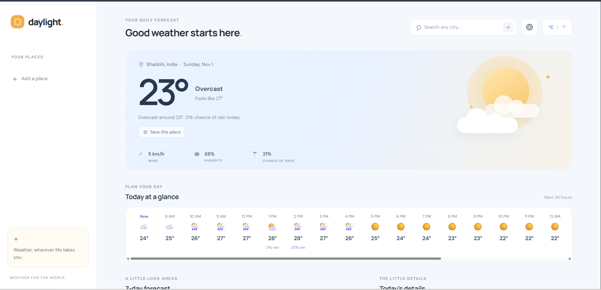

# 🌤️ WeatherApp

A responsive and interactive weather application that provides real-time weather information, forecasts, and weather details for cities around the world.

## 🚀 Live Demo

**[View WeatherApp Live](https://ankit-tripathi-31.github.io/WeatherApp/)**

## 📸 Application Preview



## 📌 About the Project

WeatherApp is a web-based application designed to help users explore current weather conditions and forecasts through a clean and user-friendly interface.

It uses the Open-Meteo API to retrieve weather and geocoding information.

## ✨ Features

- 🌍 Search for cities and explore their weather.
- 🌡️ View current temperature and weather conditions.
- 📅 Check hourly and daily weather forecasts.
- 💨 View weather details such as humidity, wind and rainfall.
- ⭐ Save favorite locations for quick access.
- 🌡️ Switch between Celsius and Fahrenheit.
- 📱 Responsive and user-friendly interface.

## 🛠️ Technologies Used

- HTML5 – Application structure.
- CSS3 – Styling and responsive layout.
- JavaScript – Application functionality and API integration.
- Open-Meteo API – Weather forecasts and geocoding.
- Git & GitHub – Version control and project hosting.
- GitHub Pages – Website deployment.

## 📂 Project Structure

```text
WeatherApp/
│
├── index.html
├── styles.css
├── app.js
└── README.md
```

## ⚙️ How to Run Locally

1. Clone this repository:

   ```bash
   git clone https://github.com/Ankit-Tripathi-31/WeatherApp.git
   ```

2. Navigate to the project folder:

   ```bash
   cd WeatherApp
   ```

3. Open `index.html` in your browser.

   Alternatively, use the Live Server extension in VS Code.

## 🌐 API Information

This project uses the free [Open-Meteo API](https://open-meteo.com/) for weather forecasts and city geocoding.

No API key is required for the public API endpoints used in this project.

## 🚀 Deployment

This project is hosted using GitHub Pages.

**Live Website:**  
https://ankit-tripathi-31.github.io/WeatherApp/

## 👨‍💻 Author

**Ankit Kumar Tripathi**

- GitHub: [Ankit-Tripathi-31](https://github.com/Ankit-Tripathi-31)
- Project Repository: [WeatherApp](https://github.com/Ankit-Tripathi-31/WeatherApp)

---

⭐ If you find this project useful, consider giving it a star on GitHub!
